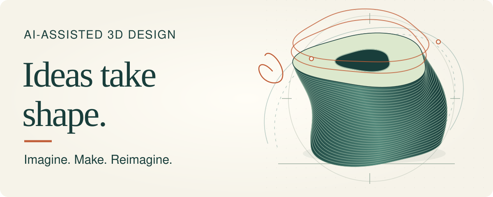
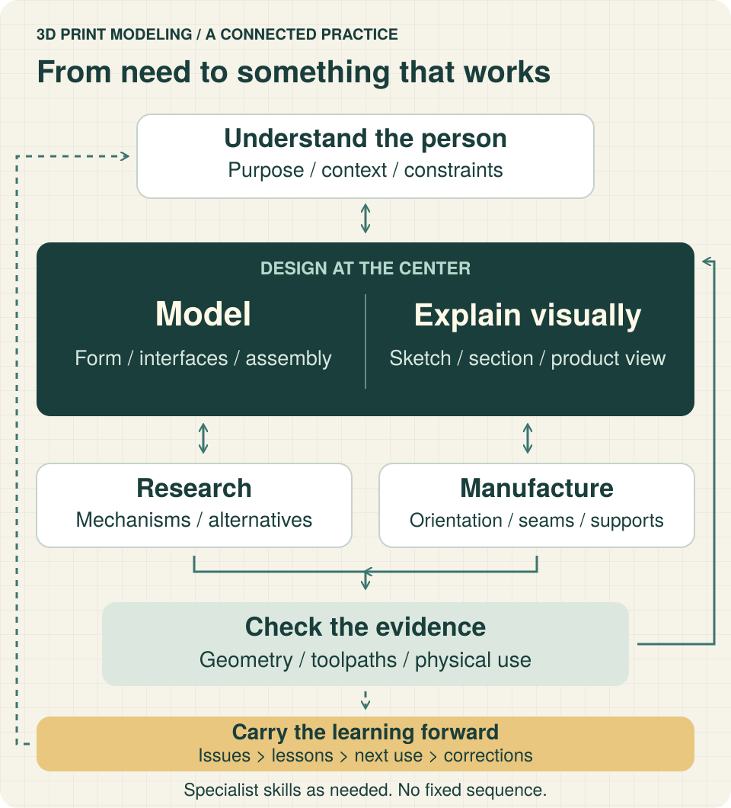

<div align="center">



# 3d-print-modeling

**Turn a human need into a design you can explain, build and improve.**

English · [简体中文](README.zh-CN.md)

[Start here](#start) · [What it does](#capabilities) · [Work with your agent](#use) · [Explore the package](#guide)

</div>

An open-ended **3D-printing project skill** for AI agents and the people making things with them. The main agent understands the goal, researches, designs, models, communicates visually and solves problems itself—bringing in specialist skills where they help.

**Modeling and visual communication are at the center.** Manufacturing choices and physical feedback inform the design, rather than reducing the project to slicer settings. Start with an idea, an existing model or a part that is not working; enter wherever the current problem needs attention.



*Original concept diagram—not a CAD render, slicer screenshot or tested physical product. Connections show feedback, not mandatory stages.*

<a id="start"></a>
## Start with one real question

You need Git to clone the package, and an AI agent that can read local Markdown files. **Reading the skill does not require a CAD engine or slicer.** Creating and checking those artifacts requires the tools appropriate to your task.

From a parent directory where `3d-print-modeling` does **not** already exist:

```sh
git clone https://github.com/Loveacup/3d-print-modeling.git 3d-print-modeling
cd 3d-print-modeling
pwd
test -f SKILL.md && test -f 'templates/核心需求.md' && printf 'Skill files found\n'
```

The repository root is the skill package; keep its `references/`, `templates/` and `agents/` alongside `SKILL.md`. The check prints `Skill files found` when those two entry files are present; it does not test agent discovery or modeling tools. The clone follows the repository's current default branch; this README describes **1.4.0**.

Open your agent in this directory—or give it the absolute directory printed by `pwd`—and paste:

```text
Read SKILL.md in this package and only the references needed for my task.
I want to design a removable desk-edge cable guide. Start with requirements
and a concept sketch, not a finished model. Ask only about unknowns that
would change the design, such as the desk interface and how the cables move.
Separate confirmed facts from assumptions, and identify the first useful check.
Do not install tools, upload files or control a printer.
```

This is an **example request, not a prebuilt model**. A useful first result is a clear account of the need, design-changing unknowns, a concept with its assumptions, and the next check. If no drawing tool is available, the agent should identify that gap rather than claim it produced an image. No dimensions, fit or printability have been validated by this example.

For ongoing work, choose a separate product-project directory. Keep its current requirements in `核心需求.md` (or one existing equivalent linked from its README); the [requirements template](templates/核心需求.md) is a starting point. Do not mix your product files into the reusable skill package.

**Want automatic skill discovery?** Place or link the complete package using your client's documented skill-discovery mechanism. Check any existing same-name skill and local edits first. Explicit file reading is the lowest-setup starting path, not proof of native skill registration; each client and its runtime must be verified separately.

<a id="capabilities"></a>
## One project, connected capabilities

| Your question | What the skill brings together |
| --- | --- |
| What should this object do—and feel like? | Research, use context, mechanisms, aesthetics and meaningful tradeoffs; ask for measurements when they change a decision. |
| How do we make the geometry work? | Original or reverse modeling, local edits, parameterization, interfaces and assembly; preserve good existing models and inspect the final geometry independently. |
| How do we see and discuss the idea? | Sketches, sections, exploded views, mechanism and problem diagrams, dimensioned drawings, product and scene imagery; choose the expression that answers the question. |
| How should we manufacture it? | Couple orientation, plate layout, color assignment, Z seams, supports, layer height, speed, flow, temperature, cooling and post-processing; return to the structure when needed. |
| Why did the result fail? | Separate observations from explanations; use measurements, references and targeted comparisons to distinguish causes, then revise the design or process. |
| How does the work stay usable? | Track deliverables, owners, dependencies, decisions and acceptance; keep editable sources, images, meshes and slicing projects tied to the correct version. |

This is a capability map, not a checklist or a fixed pipeline. A small change can stay small. A hard interface may need a local test before a polished product image; a form exploration may need sketches before precise geometry.

### Specialist tools, when the problem calls for them

Use the [tool-routing guide](references/tool-routing.md) to choose a route, and the [16-entry upstream directory](references/upstream-skills.md) to find actual sources, skill paths, version references and license notes. Both guides are currently in Chinese.

The directory covers CAD, OpenSCAD, drawings, DXF, printability analysis, slicing, standard parts, other manufacturing processes and robotics outputs. **It is navigation, not a bundled toolchain or an automatic installer.** Select only what you need; check the specialist's own triggers, dependencies and permissions before use. Optional services such as Helio are modules, not the center of the project.

When **Jev is already available**, the agent can proactively use it for bounded comparisons: which modeling route to try, which parameter or slicing candidate to test, or which diagnostic check has the most value. The main agent creates and improves candidates; Jev offers a second opinion; geometry, actual toolpaths and physical checks establish the result. Clear rules and calculations go directly to execution. Jev is optional, and this package makes no measured speed or cost-saving claim.

<a id="use"></a>
## Work with your agent

For an existing project, supply its real directory and use this handoff:

```text
Use 3d-print-modeling for the product project at the directory I provide.
Read its README/current state and latest core requirements before changing
anything. Preserve original inputs and previously approved scope.
Discover the available specialist skills and tools; read the relevant entrypoints
and check actual runtime availability rather than assuming they are installed.
Continue with the work that resolves the key unknown. Keep models and visual
explanations central; connect manufacturing choices to function and appearance.
Use the existing project-management system and its skill if available, otherwise
keep appropriately sized project-local records. Do not silently replace an
existing system if it is disconnected.
Deliver editable artifacts with exact versions and evidence. Distinguish geometry,
actual slicing/toolpath checks and physical acceptance. At completion, pause or
handoff, capture issues and supported lessons within the authorized scope,
including what to apply or correct next time. Report anything still unverified.
Ask before new installation, uploads, paid services, publication or printer actions.
```

The package supplies instructions and references, not an executable CLI, configuration service or printer controller. There is no project-specific config file or universal installation command to fill in. The substantive skill and reference documents are currently **Chinese**; these two READMEs provide complete English and Chinese entry points.

### Keep the project moving

Connect an available project-management tool through its appropriate skill—for example, `linear-flow` when it is already discoverable and suitable. Without an integration, use the product project's README and task/decision records to track outcomes, responsibility, blockers and acceptance. If an established system disconnects, retain pending updates locally and reconcile on recovery, rather than silently creating a competing source of truth.

Detailed documents, original assets and attachments stay in their owning project. Under this skill's organization method, an Obsidian vault does not hold duplicate project bodies or placeholder redirect notes. Existing material is preserved and reconciled within the authorized scope, not deleted as an automatic setup step.

### Make every use improve the next

At completion, pause or handoff of a bounded piece of work—not only at the end of the whole project:

1. **Keep the evidence.** Record what changed, the effective version, checks performed and remaining unknowns.
2. **Route the issue.** Deduplicate against the authorized issue destination; keep private assets and detailed logs in the project. If submission is unavailable or unauthorized, leave a recoverable pending item.
3. **Recover the lesson.** Merge supported methods and counterexamples into the relevant knowledge entry, with conditions and a route for finding it again. No new lesson means no invented rule.
4. **Apply, test, correct.** On the next relevant task, check applicability, use the lesson and revise it when new evidence contradicts it.

This is an agent-led practice during use, not a background watcher or automatic upload of everyone's projects. See [closeout and the knowledge loop](references/closeout.md) (Chinese).

<a id="guide"></a>
## Explore the package

The linked skill, references and template are in Chinese; file names and tool identifiers remain unchanged in both READMEs.

| Start from… | Read… |
| --- | --- |
| The main working instructions | [SKILL.md](SKILL.md) |
| Requirements and visual review | [Requirements and review](references/requirements-and-review.md) · [Core requirements template](templates/核心需求.md) |
| Research and design choices | [Reference research](references/reference-research.md) · [Design tradeoffs](references/design-tradeoffs.md) |
| Geometry and manufacturing | [Geometry validation](references/geometry-validation.md) · [Slicing and delivery](references/slicing-and-delivery.md) |
| Reusable mechanisms and interfaces | [Common structures](references/common-structures.md) · [Modular systems](references/modular-systems.md) · [Aesthetic cases](references/aesthetic-cases.md) |
| Tools and additional capabilities | [Tool routing](references/tool-routing.md) · [16 upstream skill entries](references/upstream-skills.md) |
| Coordination and learning | [Project organization](references/project-organization.md) · [Closeout](references/closeout.md) |
| Public-package scope and sources | [Publication notes](references/publication-notes.md) |

## Evidence, feedback and reuse

A concept image explains an idea; a dimensioned manufacturing drawing must come from real geometry. A valid mesh does not prove good toolpaths; a slice does not prove physical fit, appearance, strength or durability. Deliver the evidence appropriate to the intended use and name the checks still needed. Printer submission/control, purchases, cloud uploads, paid services and publication require their own authorization.

**Maintain the skill here:** [Loveacup/3d-print-modeling](https://github.com/Loveacup/3d-print-modeling). For skill defects or improvements, search [open and closed Issues](https://github.com/Loveacup/3d-print-modeling/issues?q=is%3Aissue) before posting a minimal, public-safe report. Product issues stay with their established project; this repository is not their default upload destination.

<details>
<summary>Earlier source and issue continuity</summary>

The former home was `Loveacup/jz-skills/shared/3d-print-modeling`; its [1.3.0 snapshot](https://github.com/Loveacup/jz-skills/tree/0d3530a126e6ccb7956d7ac1a30459f3f398dfc4/shared/3d-print-modeling) remains available. The collection references this independent repository through a submodule rather than maintaining a second skill body. Former main-skill issues #1 and #3 moved to this repository's [#1](https://github.com/Loveacup/3d-print-modeling/issues/1) and [#2](https://github.com/Loveacup/3d-print-modeling/issues/2); the sibling `dfam-check` issue remains in the [former repository](https://github.com/Loveacup/jz-skills/issues/2).

</details>

**Reuse and licensing:** this documentation update adds no license grant or ownership declaration. Consult the [publication notes](references/publication-notes.md) and each upstream's actual terms before copying or redistributing content, tools or third-party assets. Public availability is not permission for every use. The package does not include private models, runtime environments, service accounts or third-party implementations.
