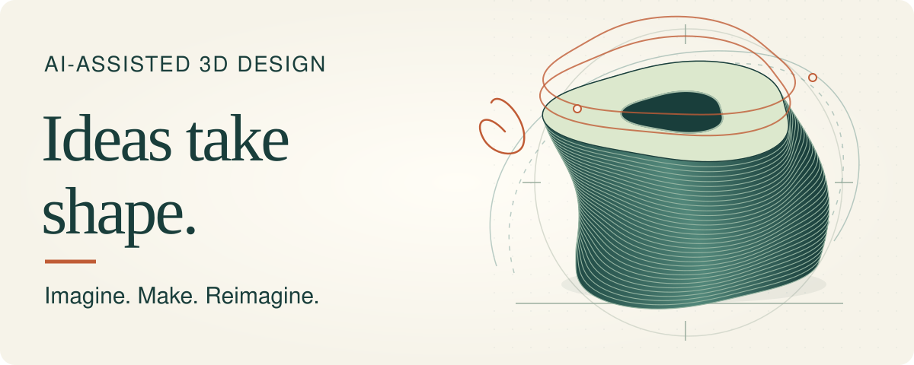
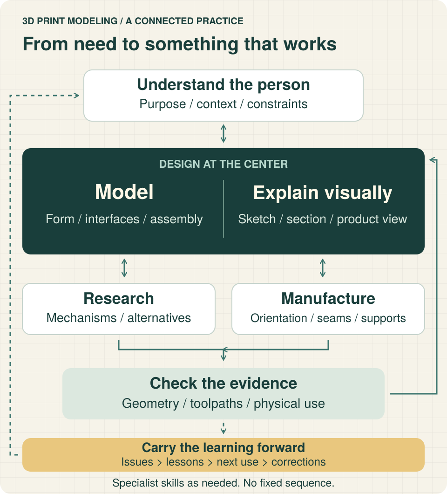

<div align="center">



# 3d-print-modeling

**Turn a human need into a 3D-printed design you can explain, build, verify and improve.**

English · [简体中文](README.zh-CN.md)

[Start here](#start) · [What it does](#capabilities) · [Work with your agent](#use) · [Explore the package](#guide) · [Evidence & boundaries](#evidence)

</div>

An open-ended **3D-printing project main skill** (`v1.7.0`) for AI agents and the people building physical objects with them. Instead of reducing a project to one-shot text-to-mesh generation or isolated slicer parameter tweaks, the main agent understands the real use case, researches mechanisms, designs, models, communicates visually and diagnoses physical or digital failures—bringing in specialist skills only when the problem calls for them.

**Modeling and visual communication stay at the center.** Manufacturing constraints, toolpath evidence and physical print feedback inform the geometry from the start. Enter wherever your current problem lives: a rough idea, site photos with measurements, an existing CAD/STL/3MF file that needs targeted modification, or a printed part that does not fit or hold up.

> **What this repository is—and is not:**
> - **Included here:** The authoritative root skill package (`SKILL.md`, on-demand `references/` guides, `templates/核心需求.md`, `agents/openai.yaml` and original concept diagrams), plus an optional standard-library native-mesh audit and synthetic tests in `scripts/`.
> - **Not included here:** No bundled CAD engine, slicer binary, third-party skill code, automatic installer, printer controller or pre-printed model library. Reading the skill requires only an AI agent that can read local Markdown files; generating or verifying CAD solids, meshes, drawings, `.3mf` projects or G-code requires the corresponding local tools.



*Original concept diagram—not a CAD render, slicer screenshot or tested physical product. Connections show feedback loops, not mandatory sequential stages.*

<a id="start"></a>
## Start with one real question

### 1. Clone and verify the skill package

You need Git and an AI agent that can read local Markdown files. **Reading and applying the skill's design workflow does not require a CAD engine or slicer installed up front.**

From a parent directory where `3d-print-modeling` does **not** already exist:

```sh
git clone https://github.com/Loveacup/3d-print-modeling.git 3d-print-modeling
cd 3d-print-modeling
pwd
test -f SKILL.md && test -f 'templates/核心需求.md' && printf 'Skill files found\n'
```

The repository root is the complete skill package; keep `references/`, `templates/`, `agents/` and the optional `scripts/` alongside `SKILL.md`.
- **Observable check:** The command prints the absolute package path followed by `Skill files found`, confirming the main entry file and core requirements template are present locally.
- **What this check does not prove:** It does not register the skill globally in a client, install upstream CAD/slicer runtimes, or validate any geometry. The clone tracks the repository's default branch; this README describes **1.7.0**.

### 2. Run a zero-install concept trial with your agent

Open your AI agent in this directory—or pass it the absolute path printed by `pwd`—and paste this trial request:

```text
Read SKILL.md in this package and only the references needed for my task.
I want to design a removable desk-edge cable guide. Start with requirements
and a concept sketch, not a finished model. Ask only about unknowns that
would change the design, such as the desk interface and how the cables move.
Separate confirmed facts from assumptions, and identify the first useful check.
Do not install tools, upload files or control a printer.
```

This is an **example prompt, not a prebuilt model**. You can tell the skill is working when the agent's first response:
1. Separates confirmed goals from unverified assumptions rather than guessing dimensions;
2. Asks only the few questions that change the structural route (such as desk thickness/edge profile, clamping vs. sliding removal, and cable count/pull direction);
3. Proposes a clear initial concept and visual review plan—or explicitly notes the missing drawing/rendering tool instead of claiming it produced an image;
4. Names the first high-value verification check before building full CAD or slicing.

No dimensions, mechanical fit or printability are validated by this read-only trial.

### 3. Move to a real product project or enable client discovery

- **Keep product files in their own directory:** For real work, create or open a separate product-project directory outside this skill repository. Maintain its active requirements in a dedicated `核心需求.md` (or one existing equivalent linked from the project's `README.md`), using [`templates/核心需求.md`](templates/核心需求.md) as a starting point. Archive site photos and measurements in the product project (`现场资料.md`), never inside this reusable skill package.
- **Optional automatic skill discovery:** If you want your agent client to discover `3d-print-modeling` automatically, place or symlink the complete repository root (`SKILL.md`, `references/`, `templates/`, `agents/`) using your client's documented skill mechanism. Inspect any existing `3d-print-modeling` directory and local edits first so you do not overwrite local work. Explicit file reading (`Read SKILL.md...`) requires zero configuration; native client discovery and specialist tool runtimes must be verified separately in each environment.

<a id="capabilities"></a>
## One project, connected capabilities

| Your question | What the skill coordinates |
| --- | --- |
| **What should this object do—and feel like?** | Clarify use actions, space utilization, retention, exclusions and aesthetic direction; organize site photos and measurements (`现场资料.md`) with explicit coordinate datums; ask for measurements only when they change a decision. |
| **How do we see and review the idea before heavy rework?** | Stage visual communication from quick intent sketches (`意向快审`) to structural sections, exploded assembly views, print-orientation callouts, dimensioned drawings and product/scene views; strictly separate AI concept images, real CAD/mesh renders and physical photos. |
| **How do we build or modify the geometry reliably?** | Route across original parametric modeling, reverse modeling or targeted local edits while preserving working native sources; independently re-read final solids and meshes to verify units, manifold topology, approved boolean modification domains (`F\B` and `B\F`), minimum wall thickness and full dynamic insertion/removal paths. |
| **How do interfaces, materials and tolerances stay predictable?** | Separate nominal dimensions, functional clearance, thermal/warpage/moisture distortion and CAD vs. slicer compensation; apply reusable joint rules (snap-fits, dovetails, printed threads, heat-set inserts, hinges, bayonets, magnets, sacrificial bridges, rigid-flex pads) and modular ecosystem notes (`Gridfinity`, `SKÅDIS`, `HSW`, `B-RAIL`); use 1:1 local interface coupons (`代表接口试片`) where risk warrants. |
| **How should we slice and deliver editable multi-plate projects?** | Couple orientation, plate layout, multi-color flushing, Z-seams, supports, layer height, volumetric flow (`Q_request = v_request * h * w`), cooling and post-processing; verify editable `.3mf` files via **save → reopen → re-slice**, checking single-set BOM vs. optional parts, multi-plate virtual grid offsets, STL-to-3MF shared vertex indexing, multi-nozzle reachable envelopes and real G-code support/bridge paths. |
| **Why did a print or assembly fail—and how does learning persist?** | Separate observed phenomena from hypotheses; compare targeted checks across requirements, geometry, toolpaths, material state and hardware; track deliverables and decisions in the project; and at each pause, handoff or completion, deduplicate issues to the authorized tracker and fold verified lessons back into the references. |

This is a capability map, not a mandatory checklist or linear six-stage pipeline. A small parameter tweak stays small. A high-risk snap-fit may need a 1:1 local test coupon before any polished rendering; an enclosure redesign may start with a quick intent sketch before writing CAD code.

### Specialist tools, when the problem calls for them

Use the [tool-routing guide](references/tool-routing.md) to choose a technical route, and the [20-entry upstream directory](references/upstream-skills.md) to inspect verified upstream repositories, skill paths, pinned reference commits, dependencies and license notes. Both guides are written in Chinese.

- **Task-based modeling selection (no single default engine):** Preserve working native CAD sources and explicit user tool choices rather than rebuilding good models to fit a preferred tool. For new work, consider **SolidCraft** (`solidcraft-modeling`, `solidcraft-editing`, `solidcraft-checking`, `solidcraft-mechanisms`) when constrained sketches, editable feature history, shells/fillets, STEP delivery or mechanisms are primary; consider **OpenSCAD** (`openscad`) for regular functional parts, scripted rebuilds and `.scad` delivery; or use `cad` / mesh tools where they fit better. When a new route choice significantly affects future editing or delivery, the agent explains the tradeoff, recommends a route and asks first—or proceeds autonomously when delegated.
- **Programmatic-first execution:** The skill prioritizes available CLI commands, scripts, direct file/3MF/G-code inspection and direct image reading over GUI automation, using GUI control only when requested or required by the tool and authorized.
- **On-demand navigation, not a bundled installer:** The 20-entry directory covers SolidCraft's 4 skills, `cad`, `openscad`, `flowful-cad` (upstream `parametric-3d-printing`), `engineering-drawing`, `dxf`, `dfam-check`, `gcode` (OrcaSlicer), `bambu-studio-ai`, `bambu-labs`, `step-parts`, `dfm`, `sendcutsend`, `urdf`, `srdf`, `sdf` and `answer-me-with-html`. Check each specialist skill's triggers, runtime stack and license before installing or running it. SolidCraft skills and runtime must be obtained from their upstream repository separately; this package includes no local launcher or compatibility patch. Optional external optimizers such as Helio remain optional modules, not the center of the workflow.
- **Bounded second opinions with Jev (when available):** When `jev-sidekick` (`jev_evaluate`) is already available in the environment, the agent can proactively use it to compare a small set of well-defined candidates—which modeling route to try first, which parameter or slicing tradeoff to test, or which diagnostic check carries the highest information value. Deterministic rules and calculations go straight to execution. The main agent creates candidates, Jev offers a relative recommendation (`confidence` reflects option concentration, not probability of structural or print success), and independent geometry, toolpath and physical checks decide the outcome.

<a id="use"></a>
## Work with your agent

When starting or continuing a real product project in its own directory, provide that project's path and use this handoff prompt:

```text
Use 3d-print-modeling for the product project at the directory I provide.
Read its README/current state and latest core requirements (核心需求.md) before
changing anything. Preserve original inputs, baseline files and approved scope.
Discover the available specialist skills and tools; read the relevant entrypoints
and verify actual runtime availability rather than assuming they are installed.
Continue with the work that resolves the key unknown. Keep models and visual
explanations central; connect manufacturing choices to function and appearance.
Use the existing project-management system and its skill if available, otherwise
keep appropriately sized project-local records. Do not silently replace an
existing system if it is disconnected.
Deliver editable artifacts with exact versions and evidence. Distinguish geometry,
actual slicing/toolpath checks and physical acceptance. At completion, pause or
handoff, capture issues and supported lessons within the authorized scope,
including what to apply or correct next time. Report anything still unverified.
Ask before new installation, uploads, paid services, publication or printer actions.
```

The package provides engineering instructions and reference guides—not an executable CLI, daemon service or printer controller. There is no `config.json`, environment variable or universal installer to populate. The substantive skill and reference documents are currently written in **Chinese**; `README.md` and [`README.zh-CN.md`](README.zh-CN.md) provide complete English and Simplified Chinese entry points.

### Keep the project organized and recoverable

- **Single source of truth for requirements and site data:** Every product project keeps an independent `核心需求.md` (updated when confirmed requirements change, never silently overwritten to hide unmet goals) and, when physical references exist, a linked `现场资料.md` tracking original photos, annotations, measurement datums and known tolerances.
- **Project-management integration with local fallback:** Connect an available project-management workflow through its skill (such as `linear-flow` when discoverable and authorized). Without an external integration, track deliverables, owners, blockers, decisions and acceptance in the product project's `README.md` and local task records. If an established external system is temporarily unreachable, record pending updates locally and reconcile on recovery rather than silently creating a competing source of truth.
- **Project-owned files (no Obsidian duplication):** Detailed documents, CAD sources, meshes, `.3mf` projects and attachments stay in their owning product project directory. Under this skill's organization rules, an Obsidian vault does not keep duplicate project bodies or redirect placeholder notes; existing material is verified and reconciled within the authorized scope, never deleted as an automatic setup step.

### Make every use improve the next

At the completion, pause or handoff of any bounded unit of work—not only at the end of an entire project:

1. **Record the evidence.** Summarize what changed, the effective file versions/hashes, what was verified (solid/mesh, slice/toolpath, or physical) and what remains unverified.
2. **Route the issue.** Deduplicate problems (including solved obstacles and diagnostic counterexamples) against the authorized GitHub issue tracker; keep private models, site photos, credentials and raw logs local to the product project. If remote submission is unauthorized or offline, record a recoverable pending item locally.
3. **Fold back the lesson.** Merge evidence-backed methods and failure boundaries into the relevant reference or case file so the next session finds them by problem route. If a session yields no new generalizable lesson, state that plainly rather than inventing rules.
4. **Apply, verify and correct.** On the next related task, check whether prior conditions still hold before reusing a conclusion, verify any changed variables and revise earlier guidance when new evidence contradicts it.

This loop is executed deliberately by the agent during active work—never via background watchers or automatic uploads. See [closeout and the knowledge loop](references/closeout.md) (Chinese).

### Optional: exact native-mesh audit (Python 3)

For a deterministic STL-to-3MF export that should preserve triangulation, the package includes an independent paired audit. With your own STL and 3MF, from the repository root:

```sh
python scripts/audit_native_mesh.py --source part.stl --source-unit millimeter --project model.3mf --object-id 1
python -B -m unittest discover -s scripts/tests -v
```

The first command writes JSON to stdout and declares the source unit and selected native object. It compares oriented triangle multisets after finite-float parsing, allowing index/cyclic reordering but preserving winding and duplicate multiplicity; decimal conversion can round or underflow. It does **not** validate schema, role pairing, build transforms, general surface equivalence, slicing or printability. Optional file output refuses existing or input paths. Reports contain input paths and file hashes: review their sensitivity before sharing. The tests use temporary synthetic meshes, not a CAD engine or slicer; Python 3.12 was used for validation, and other Python versions have not been verified. See [geometry scope](references/geometry-validation.md#确定性导出的原生网格比对) and [release boundaries](references/publication-notes.md#原生网格探针与证据边界). Python is needed only for this optional tool, with no third-party dependencies.

Model-only 3MF, editable slicing projects and pre-sliced output follow [different delivery checks](references/slicing-and-delivery.md#3mf交付类型与补格式); the extension alone does not imply machine presets or toolpaths.

<a id="guide"></a>
## Explore the package

All repository documentation below is in Chinese except `README.md`; file paths, skill identifiers and version references are identical across both READMEs.

| If you need to… | Read… |
| --- | --- |
| Understand the main workflow and problem routing | [SKILL.md](SKILL.md) · [Client interface metadata](agents/openai.yaml) |
| Clarify requirements, archive site measurements and stage visual reviews | [Requirements and visual review](references/requirements-and-review.md) · [Core requirements template](templates/核心需求.md) |
| Research official printer/slicer docs, evaluate reference models and weigh design tradeoffs | [Reference research & Bambu Wiki verification](references/reference-research.md) · [Design tradeoffs & image boundaries](references/design-tradeoffs.md) |
| Validate parametric solids, meshes, boolean domains and material fit | [Geometry, wall thickness & assembly validation](references/geometry-validation.md) · [Brief printing profile](references/user-printing-profile.md) |
| Optimize orientation, supports, multi-plate `.3mf` delivery and G-code checks | [Rendering, Bambu 3MF & support delivery](references/slicing-and-delivery.md) |
| Reuse proven FDM joints, project patterns and mechanism analyses | [Common FDM structure cards](references/common-structures.md) · [Reusable project patterns](references/project-patterns.md) · [Reference mechanisms](references/reference-mechanisms.md) |
| Adapt modular storage/mounting ecosystems or study form/partition cases | [Modular systems overview](references/modular-systems.md) ([Gridfinity](references/modular-systems/gridfinity.md) · [SKÅDIS](references/modular-systems/skadis.md) · [HSW](references/modular-systems/honeycomb.md) · [B-RAIL](references/modular-systems/b-rail.md) · [source-index.tsv](references/modular-systems/source-index.tsv)) · [B-RAIL thinning case](references/b-rail-case.md) · [Aesthetic cases](references/aesthetic-cases.md) |
| Route to specialist skills, use Jev comparisons or check upstream installation | [Tool routing & Jev sidekick](references/tool-routing.md) · [20 upstream skill entries](references/upstream-skills.md) |
| Organize project files, coordinate with Dot and run the closeout loop | [Project organization](references/project-organization.md) · [Dot-local collaboration](references/dot-local-collaboration.md) · [Closeout & knowledge loop](references/closeout.md) · [Session sources & evidence tiers](references/session-sources.md) |
| Check public package scope, v1.1.0–v1.7.0 changes and literature/license citations | [Publication notes](references/publication-notes.md) |

<a id="evidence"></a>
## Evidence, feedback and reuse

- **Evidence is layered, never conflated:**
  - *Concept / AI visuals* communicate form and intent; they never establish dimensions, tolerances or printability.
  - *Geometry verification* checks units, solid/mesh validity, approved modification domains (`F\B` and `B\F`), wall thickness and dynamic assembly paths on the actual deliverable files.
  - *Slicing and toolpath verification* requires saving, reopening and re-slicing the editable `.3mf` across all plates, inspecting virtual plate grids, nozzle reachability and actual G-code extrusion paths (`Support`, bridges, layer times and compensation).
  - *Physical acceptance* requires real printing, support removal, assembly and service loading under the target material and environment. Unrun checks must always be reported as unverified.
- **Explicit authorization boundaries:** Installing tools or packages, uploading private files, calling paid APIs, publishing code or models, and submitting or controlling prints each require separate user approval.
- **Skill maintenance and issue tracker:** This skill is maintained at [Loveacup/3d-print-modeling](https://github.com/Loveacup/3d-print-modeling). Before opening an issue about a skill defect or workflow improvement, search [open and closed Issues](https://github.com/Loveacup/3d-print-modeling/issues?q=is%3Aissue) and submit only minimal, public-safe summaries. Issues belonging to a specific user product project stay in that project's authorized tracker; this repository is not a default upload destination for private projects.

<details>
<summary>Earlier repository history and migrated issues</summary>

The skill previously lived in `Loveacup/jz-skills/shared/3d-print-modeling`; its [1.3.0 historical snapshot](https://github.com/Loveacup/jz-skills/tree/0d3530a126e6ccb7956d7ac1a30459f3f398dfc4/shared/3d-print-modeling) remains readable. The parent collection now references this standalone repository via submodule rather than maintaining a duplicate skill body. Former main-skill issues #1 and #3 were migrated to this repository's [#1](https://github.com/Loveacup/3d-print-modeling/issues/1) and [#2](https://github.com/Loveacup/3d-print-modeling/issues/2); the sibling `dfam-check` issue remains in the [former repository (#2)](https://github.com/Loveacup/jz-skills/issues/2).

</details>

**Reuse and licensing:** This documentation update adds no new license grant or ownership declaration. Review the [publication notes](references/publication-notes.md) and each upstream repository's or reference model's actual license terms before copying, adapting or redistributing content, tools or third-party designs. Public readability does not imply unrestricted commercial or redistribution rights. This package bundles no private models, runtime environments, service credentials or third-party skill implementations.
