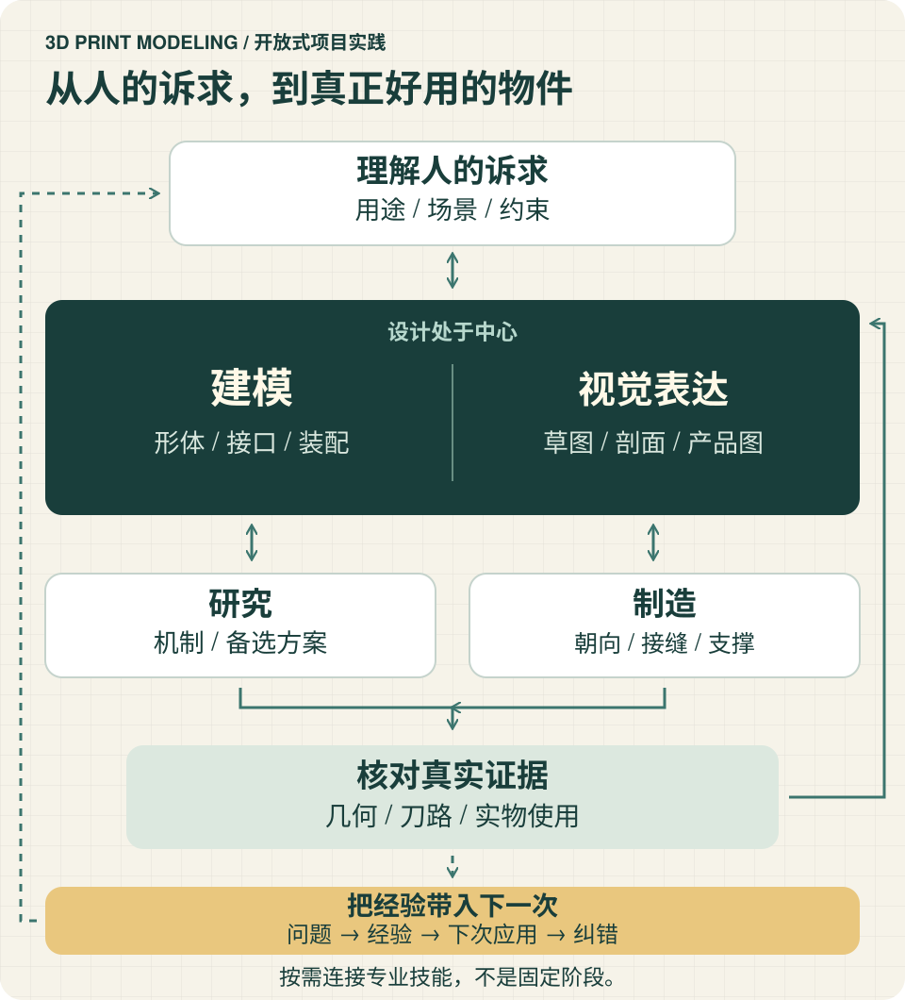

<div align="center">


# 3d-print-modeling

**把人的真实诉求，变成能讲清、能制造、能核验、能持续改进的 3D 打印设计。**

[English](README.md) · 简体中文

[开始使用](#start) · [能做什么](#capabilities) · [与 Agent 协作](#use) · [深入阅读](#guide) · [证据与边界](#evidence)

</div>

这是面向 AI Agent 与创作者的开放式 **3D 打印项目主技能**（当前版本 `v1.6.1`）。它不把 3D 打印项目简化成一次性“文字生成网格”或孤立的切片参数调整，而是让主模型真正理解人的使用目标，亲自研究机制、设计方案、建模、视觉表达并诊断数字或实物问题；只在任务确实需要时按需连接专业 skills，把各环节接成完整、可交付的项目。

**建模与视觉表达始终处于中心。** 制造条件、真实刀路与实物反馈从一开始就参与设计判断。你可以从一个模糊想法、带尺现场照片、需要局部改动的现有 CAD/STL/3MF 文件，或者已经打印出来但配合不好、容易损坏的零件切入，直接从当前最关键的未知开始工作。

> **本仓库是什么、不是什么：**
> - **本仓库包含：** 位于仓库根目录的权威主技能包（`SKILL.md`、按需读取的 `references/` 参考指南、`templates/核心需求.md`、`agents/openai.yaml` 及原创概念图）。
> - **本仓库不包含：** 不捆绑 CAD 引擎、切片器二进制程序、第三方配套 skill 源码、自动安装器、打印机控制器或现成打印模型库。阅读并应用主技能方法只需能读取本地 Markdown 的 AI Agent；真正生成或验证 CAD 实体、网格、工程图、`.3mf` 切片工程或 G-code 时，再调用本机相应工具。



*原创概念示意，不是 CAD 渲染、切片截图或经过验证的实物。连线表示反馈回路，不代表必须依次走完的固定阶段。*

<a id="start"></a>
## 从一个真实问题开始

### 1. 克隆并核验技能包

你需要 Git，以及一个能读取本地 Markdown 文件的 AI Agent。**阅读并启动本技能的设计梳理流程，不需要预先安装 CAD 引擎或切片器。**

在一个尚不存在 `3d-print-modeling` 子目录的父目录中运行：

```sh
git clone https://github.com/Loveacup/3d-print-modeling.git 3d-print-modeling
cd 3d-print-modeling
pwd
test -f SKILL.md && test -f 'templates/核心需求.md' && printf 'Skill files found\n'
```

仓库根目录就是完整技能包；请保留 `SKILL.md` 同级的 `references/`、`templates/` 和 `agents/`。
- **可观察的成功判据：** 命令会打印当前技能包的绝对路径，并在两份入口文件存在时输出 `Skill files found`。
- **该检查不证明什么：** 它不测试客户端全局技能注册、不安装上游 CAD／切片运行环境，也不验证任何模型几何。克隆默认跟随仓库当前主分支；本 README 对应 **1.6.1**。

### 2. 免安装跑通第一次概念梳理

在此目录打开你的 AI Agent，或把 `pwd` 输出的绝对路径交给它，粘贴以下体验请求：

```text
读取这个技能包的 SKILL.md，只按当前问题读取需要的参考。
我想设计一个可拆卸的桌边理线件。先做需求梳理和概念草图，不直接生成最终模型。
只问会改变设计的未知，比如桌边接口和线缆的使用动作。
把已确认事实与假设分开，指出最先值得做的检查。
不要安装工具、上传文件或控制打印机。
```

这是**示例请求，不是随包附送的现成模型**。当 Agent 的首轮回复满足以下表现时，说明技能已按方法生效：
1. 把已确认诉求与待验证假设明确分开，不凭空猜测桌面厚度或线径；
2. 只追问会改变结构路线的关键未知（如桌沿截面与厚度、夹持还是滑入拆卸、线缆数量与拉扯方向）；
3. 给出带假设的初步概念与视觉快审方向；若当前环境没有可用绘图工具，如实说明缺口，而不是声称已经出图；
4. 在进入完整 CAD 或切片前，指出最值得先做的第一项验证检查。

这轮只读体验不验证具体尺寸、装配配合或实际可打印性。

### 3. 进入真实产品项目或配置客户端自动发现

- **产品项目使用独立目录：** 持续开展具体产品设计时，请在技能仓库之外另建或打开独立的产品项目目录。在项目内用独立的 `核心需求.md`（或由项目 `README.md` 指向唯一现行入口）维护当前要求，可直接以 [`templates/核心需求.md`](templates/核心需求.md) 为起点；现场照片与量测归入产品项目自己的 `现场资料.md`，不要把私人产品文件混入可复用的技能包。
- **可选的客户端自动发现：** 若希望客户端自动发现 `3d-print-modeling`，请按该客户端文档规定的技能发现机制放置或符号链接完整根目录（含 `SKILL.md`、`references/`、`templates/`、`agents/`）；操作前先检查是否已有同名技能及本地改动，避免静默覆盖。直接让 Agent 读取本地 `SKILL.md` 是零配置的起步方式；各客户端的原生技能加载与专业工具运行环境仍需分别验证。

<a id="capabilities"></a>
## 一个项目，连接多种能力

| 你当前面对的问题 | 主技能协调的工作 |
| --- | --- |
| **这个物件应该怎样用、给人什么感受？** | 澄清使用动作、空间利用、保持方式、排除项与审美方向；按收到即整理原则维护带坐标基准的 `现场资料.md`；只在尺寸会改变判断时要求量测。 |
| **怎样在投入重改前看见并讨论方案？** | 按问题组织意向快审草图、结构剖面、爆炸装配图、打印方向标注、真实几何尺寸图与产品／场景图；严格区分 AI 灵感概念图、真实 CAD／网格视图与实物照片。 |
| **几何怎样建模或改模才可靠？** | 按已有源、编辑与交付需求路由原创参数化建模、逆向或局部改模，保留好用的原生源；建模后独立读回最终实体与网格，核对单位、流形拓扑、批准修改域布尔差集（`F\B` 与 `B\F`）、全域最小余厚及动态装拆／工具可达路径。 |
| **接口、材料与配合公差怎样保持可控？** | 区分名义尺寸、功能间隙、热收缩／翘曲／吸湿变形与 CAD 或切片补偿；按需选用常用结构卡（卡扣、燕尾轨、打印螺纹、热熔嵌件、铰链、旋锁、磁吸、牺牲桥层、刚柔衬垫）与模块化生态笔记（`Gridfinity`、`SKÅDIS`、`HSW`、`B-RAIL`）；高风险接口优先做 1:1 局部代表试片。 |
| **怎样切片并交付可编辑的多盘工程？** | 联动摆向、摆盘、多色冲刷、Z 缝、支撑、层高、体积流量限速（`Q_request = v_request * h * w`）、冷却与后处理；可编辑 `.3mf` 工程执行**保存 → 重开 → 复切**全盘验证，核查单套零件与互斥选配、多盘增减后的虚拟盘格偏移、STL 直写 3MF 的共享顶点索引、多喷头可达域，以及真实 G-code 支撑／桥接路径。 |
| **为什么结果不好用，经验怎样留到下一次？** | 区分观察现象与原因推测，沿需求、几何、刀路、材料状态与硬件做高信息价值的局部对照；在项目内追踪成果与决定；每次完成、暂停或交接时查重归集问题，并将有依据的方法和反例回写到对应参考。 |

这是能力地图，不是必须逐项打卡的清单，也不是固定六阶段流水线。简单小改保持简单；高风险卡扣可以先做 1:1 局部试片再谈渲染美化；外形重构可以先用简图快审方向再写精确 CAD。

### 按问题连接专业工具

用 [工具导航](references/tool-routing.md) 选择路线，再用 [20 项配套技能上游目录](references/upstream-skills.md) 查找真实公开仓库、技能路径、固定提交依据、运行依赖与许可注意项。两份指南均为中文。

- **按场景选择建模路线（不设单一默认引擎）：** 优先保留有效的原生可编辑源和用户明确指定的工具，不为统一工具而推翻重建好用的模型。新建任务中，需要参数化实体、草图约束、可编辑特征历史、外壳／圆角、STEP 交付或机构装配时优先考虑 **SolidCraft**（`solidcraft-modeling`、`solidcraft-editing`、`solidcraft-checking`、`solidcraft-mechanisms`）；规则功能件、脚本化重建和 `.scad` 源交付优先考虑 **OpenSCAD**（`openscad`）；复杂实体或局部网格修改按需选 `cad` 或相应网格工具。重要新路线先说明候选取舍、给出推荐并询问用户；用户委托自主决定时直接推进，普通小改不反复请批。
- **优先程序化处理：** 建模、分盘、切片、保存与核查优先走当前可用的 CLI、脚本、文件／3MF／G-code 解析与直接读图；仅在用户明确要求界面操作或必要操作无法经程序化路径完成时，按工具技能与授权使用 GUI。
- **按需导航，而非捆绑工具链或自动安装器：** 上游目录覆盖 SolidCraft 四项技能、`cad`、`openscad`、`flowful-cad`（上游名 `parametric-3d-printing`）、`engineering-drawing`、`dxf`、`dfam-check`、`gcode`（OrcaSlicer）、`bambu-studio-ai`、`bambu-labs`、`step-parts`、`dfm`、`sendcutsend`、`urdf`、`srdf`、`sdf` 与 `answer-me-with-html`。只选择当前任务需要的能力，使用前核对其触发条件、依赖栈与许可证。SolidCraft 技能与运行时需另从已核上游获取，本包不含本机 launcher 或兼容补丁。Helio 等外部服务只是可选后段模块，不是整个项目的中心。
- **Jev 按需判断副手（当前环境已具备时）：** 当环境中已有 `jev-sidekick`（`jev_evaluate`）时，Agent 可在有清晰目标与有限可比候选时主动调用它辅助比较——例如先试哪条建模路线、哪组参数或切片联动方案、下一项诊断检查哪一个信息价值更高。已知规则与算术能决定的事直接计算推进。主模型负责提出与改进候选，Jev 提供相对建议（`confidence` 仅反映选项概率集中度，不代表结构安全或打印通过率），最终结论仍由几何复核、真实刀路和实物检验决定。

<a id="use"></a>
## 与 Agent 协作

接手或推进独立目录中的真实产品项目时，提供该项目的实际目录，并使用这段交接请求：

```text
使用 3d-print-modeling 处理我提供目录中的产品项目。
修改前先读项目 README / 当前状态和最新核心需求（核心需求.md），保全原始输入、基线文件及已批准范围。
发现当前可用的专业 skills 和工具，读取相关入口并核实际运行条件，不假定已经安装。
优先推进能解决关键未知的工作。让建模和视觉表达处于中心，
把制造选择与功能、外观联系起来。
已有项目管理系统及协作 skill 时沿用；没有接入就在项目内做适合规模的记录。
已有系统断联时不要静默更换正本。
交付可编辑产物、准确版本和证据，区分几何、真实切片/刀路与实物验收。
本轮完成、暂停或交接时，在授权范围内归集问题与有依据的经验，
说明下次怎样应用或纠正，并如实报告未验证项。
新增安装、上传、付费服务、公开发布或打印机动作前先确认授权。
```

本包提供工程工作方法与参考指南，不是可执行 CLI、常驻服务或打印设备控制器。没有需要手填的 `config.json`、环境变量或跨客户端通用安装命令。技能正文与参考资料目前为**中文**；[`README.md`](README.md) 与 `README.zh-CN.md` 提供完整英中双语入口。

### 让项目资料与状态持续可用

- **核心需求与现场资料唯一入口：** 每个产品项目独立维护 `核心需求.md`（随已确认需求更新，绝不用改写文档掩盖未满足项）；收到现场照片、带尺照片或量测时，当轮归档并更新项目独立的 `现场资料.md`，关联原图、视角、坐标基准与已知误差。
- **项目管理接入与本地后备：** 环境中有适用项目管理软件及协作 skill（如已发现且获准的 `linear-flow`）时直接接续；无外部接入时，在产品项目 `README.md` 和本地任务／决定记录中管理成果、责任、依赖、阻塞与验收。已接入系统临时断联时，在本地保留待同步更新，恢复后核对合并，不静默另立竞争正本。
- **资料留在所属项目（Obsidian 不留副本）：** 详细文档、原始参考模型、CAD 源、网格、`.3mf` 工程与附件统一留在所属产品项目目录。按本技能的组织规则，Obsidian 知识库不保留项目正文副本或跳转占位笔记；既有外部资料在授权范围内核对收敛，不把删除资料当作自动安装步骤。

### 让每次使用改善下一次

在每轮有明确范围的工作完成、暂停或交接时执行，不必等整个项目结束：

1. **留下证据。** 对照最新核心需求记录改了什么、有效版本／哈希、实际完成的检查（实体／网格、切片／刀路或实物）以及剩余未知。
2. **归集问题。** 在已授权的 GitHub Issues 归属中查重并记录问题（含已解决障碍、方法与反例）；私人模型、现场照片、凭据与完整日志留在项目本地。无通道或未获授权时，在项目内保留可恢复的待提交项。
3. **提炼经验。** 将有依据的方法与适用条件合并到最相关的 reference 或案例，并在问题路由中留好入口；本轮无新增通用经验就如实写“无需修改”，不硬造规则。
4. **应用、验证、纠错。** 下次遇到相关任务先核适用条件是否仍成立，对变化部分补做验证；新证据推翻旧判断时及时修正知识范围并保留溯源。

这是 Agent 在工作过程中主动执行的闭环，不包含后台监听或自动上传。详见 [每次使用后的问题与知识循环](references/closeout.md)。

<a id="guide"></a>
## 深入阅读

除英文版 `README.md` 外，以下技能正文、参考指南与模板均为中文；两版 README 中的文件路径、技能标识与版本号完全一致。

| 想了解或解决…… | 阅读入口 |
| --- | --- |
| 主技能工作流与按问题路由 | [SKILL.md](SKILL.md) · [客户端界面描述](agents/openai.yaml) |
| 核心需求维护、现场照片／量测归档与分阶段图审 | [需求、测量与审核草图](references/requirements-and-review.md) · [核心需求模板](templates/核心需求.md) |
| 拓竹官方 Wiki 查证、参考模型研究与方案／图像边界取舍 | [参考研究与官方知识查证](references/reference-research.md) · [方案取舍与图源边界](references/design-tradeoffs.md) |
| 参数化源、实体／网格独立复核、修改域差集与材料配合诊断 | [几何、余厚与装配复核](references/geometry-validation.md) · [简短设备与材料档案](references/user-printing-profile.md) |
| 摆向、支撑、多盘 `.3mf` 保存重开复切与真实 G-code 核查 | [渲染、Bambu 3MF 与支撑交付](references/slicing-and-delivery.md) |
| 常用 FDM 连接结构、跨项目复用模式与公开机构分析 | [常用结构小卡](references/common-structures.md) · [项目中可复用的结构](references/project-patterns.md) · [按需参考机构](references/reference-mechanisms.md) |
| 模块化收纳／挂载接口复用、导轨减薄保护与造型分区案例 | [模块化收纳接口总览](references/modular-systems.md)（[Gridfinity](references/modular-systems/gridfinity.md) · [SKÅDIS](references/modular-systems/skadis.md) · [HSW](references/modular-systems/honeycomb.md) · [B-RAIL](references/modular-systems/b-rail.md) · [来源索引](references/modular-systems/source-index.tsv)）· [B-RAIL 减薄案例](references/b-rail-case.md) · [按需造型与分区案例](references/aesthetic-cases.md) |
| 建模路线选择、专业技能衔接、Jev 副手与 20 项上游按需安装 | [按任务连接专业能力](references/tool-routing.md) · [20 项配套技能上游目录](references/upstream-skills.md) |
| 项目文件组织、Dot 协同与每次使用后的问题／知识闭环 | [项目管理、文档与接续](references/project-organization.md) · [Dot 与本地执行会话协作](references/dot-local-collaboration.md) · [每次使用收尾与知识循环](references/closeout.md) · [来源记录与证据分层](references/session-sources.md) |
| 公开包范围、v1.1.0–v1.6.1 演进记录及一手文献／源码／许可依据 | [公开发布范围 · 1.6.1](references/publication-notes.md) |

<a id="evidence"></a>
## 证据、反馈与复用

- **证据严格分层，不跨层冒充：**
  - *概念图与 AI 意向图* 用于探索和讲清想法，不能用来读尺寸、判配合或证明可打印性。
  - *几何复核证据* 来自对最终实体与网格的独立读回，核验单位、水密／流形拓扑、批准空间修改域（`F\B` 与 `B\F`）、最小余厚及动态装拆路径。
  - *切片与刀路证据* 要求可编辑 `.3mf` 工程完成**保存 → 重开 → 全盘复切**，核对多盘虚拟盘格、喷头可达域及真实 G-code 中的支撑、桥接、层时间与尺寸补偿生效情况。
  - *实物验收证据* 来自目标机器、材料与真实工况下的打印、拆撑、试装、承载与耐久表现；未执行的检查必须如实标记为“待验证”。
- **明确的权限边界：** 安装新工具或依赖、上传私有文件、调用付费服务、公开发布代码或模型，以及提交打印任务或控制打印设备，均需分别取得用户明确授权。
- **技能维护与问题反馈：** 本技能在 [Loveacup/3d-print-modeling](https://github.com/Loveacup/3d-print-modeling) 独立维护。反馈技能缺陷或改进建议前，请先搜索 [未关闭与已关闭 Issues](https://github.com/Loveacup/3d-print-modeling/issues?q=is%3Aissue)，仅提交必要且可公开的去敏摘要。使用者具体产品项目的问题沿用所属项目的既定归属，本仓库不是私人项目的默认上传目的地。

<details>
<summary>旧仓库来源与问题迁移历史</summary>

本技能早期位于 `Loveacup/jz-skills/shared/3d-print-modeling`，其 [1.3.0 历史快照](https://github.com/Loveacup/jz-skills/tree/0d3530a126e6ccb7956d7ac1a30459f3f398dfc4/shared/3d-print-modeling) 仍可查阅。原合集现通过子模块引用本独立仓库，不再维护第二份技能正文。主技能原 Issues #1、#3 已迁移为本仓库 [#1](https://github.com/Loveacup/3d-print-modeling/issues/1)、[#2](https://github.com/Loveacup/3d-print-modeling/issues/2)，保留原评论与跳转；兄弟技能 `dfam-check` 的问题仍留在 [旧仓库 (#2)](https://github.com/Loveacup/jz-skills/issues/2)。

</details>

**复用与许可：** 本次文档更新不新增许可授权或权利归属声明。复制、改编或再分发文本、工具及第三方设计前，请先查阅 [发布说明](references/publication-notes.md) 以及各配套上游仓库、参考模型的真实许可条款；公开可读不代表任何用途均已获准。本公开包不包含私人模型、运行环境、服务账户凭据或第三方技能实现代码。
