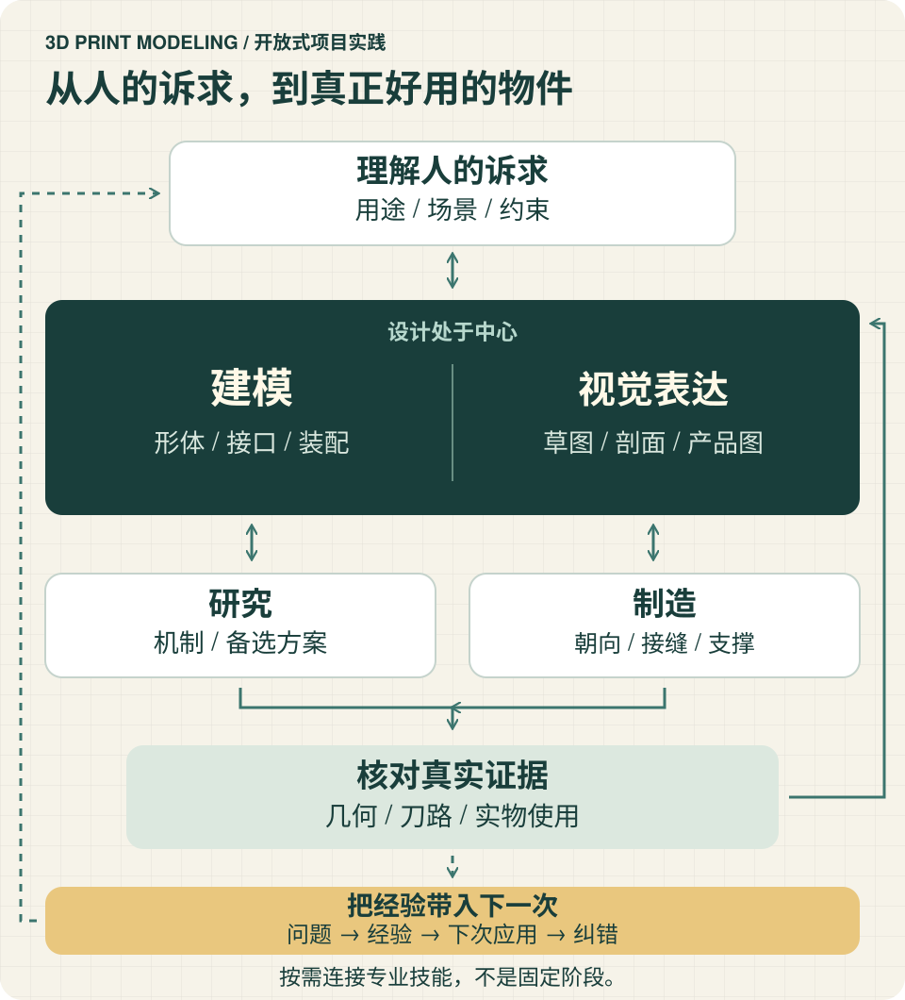

<div align="center">

# 3d-print-modeling

**把人的诉求，变成能讲清、能制造、能持续改进的设计。**

[English](README.md) · 简体中文

[开始使用](#start) · [能做什么](#capabilities) · [与 Agent 协作](#use) · [深入阅读](#guide)

</div>

这是面向 AI Agent 与创作者的开放式 **3D 打印项目主技能**。主模型理解目标，亲自研究、设计、建模、视觉表达与解决问题，在需要时组织专业 skills，把结果接成完整项目。

**建模与视觉表达是核心。** 制造选择与实物反馈共同推动设计，而不是把整个项目缩成切片参数调整。可以从一个想法、已有模型或不好用的零件开始，按当前问题进入，不必从头跑一套流程。



*原创概念示意，不是 CAD 渲染、切片截图或经过验证的实物。连线表示反馈关系，不代表必须依次完成的阶段。*

<a id="start"></a>
## 从一个真实问题开始

克隆需要 Git；使用需要能读取本地 Markdown 文件的 AI Agent。**阅读主技能不需要 CAD 引擎或切片器。** 真正生成和检查相应产物时，再核验任务所需工具。

在一个尚不存在 `3d-print-modeling` 子目录的父目录中运行：

```sh
git clone https://github.com/Loveacup/3d-print-modeling.git 3d-print-modeling
cd 3d-print-modeling
pwd
test -f SKILL.md && test -f 'templates/核心需求.md' && printf 'Skill files found\n'
```

仓库根目录就是技能包；保留 `SKILL.md` 同级的 `references/`、`templates/` 和 `agents/`。两份入口文件存在时，检查命令会输出 `Skill files found`；这不验证客户端发现或建模工具。克隆获取仓库当前默认分支；本 README 介绍的是 **1.4.0**。

在此目录打开 Agent，或把 `pwd` 输出的绝对目录交给它，然后粘贴：

```text
读取这个技能包的 SKILL.md，只按当前问题读取需要的参考。
我想设计一个可拆卸的桌边理线件。先做需求梳理和概念草图，不直接生成最终模型。
只问会改变设计的未知，比如桌边接口和线缆的使用动作。
把已确认事实与假设分开，指出最先值得做的检查。
不要安装工具、上传文件或控制打印机。
```

这是**示例请求，不是随包附送的模型**。第一轮有用的结果是：明确诉求、列出影响设计的未知、给出带假设的概念，以及下一项检查。如果没有可用绘图工具，Agent 应明确缺口，而不是声称已经出图。这个示例没有验证尺寸、配合或可打印性。

持续开展产品工作时，另选产品项目目录，用独立的 `核心需求.md` 保存当前要求；已有同用途文件可以沿用，由项目 README 指向唯一入口。[核心需求模板](templates/核心需求.md) 可作起点。不要把产品文件混入可复用的技能包。

**希望客户端自动发现技能？** 按该客户端的正式技能发现方式，放置或链接完整技能包；先检查已有同名技能的来源和本地改动。直接读取文件是配置最少的起步方式，不证明原生技能已注册；各客户端与运行环境仍需分别验证。

<a id="capabilities"></a>
## 一个项目，连接多种能力

| 你当前的问题 | 主技能组织的工作 |
| --- | --- |
| 这个物件应该怎样用、给人什么感受？ | 研究使用场景、机制、审美与关键取舍；尺寸会改变判断时再要求量测。 |
| 几何怎样实现才合理？ | 原创或逆向建模、局部修改、参数化、接口与装配；保留已有好用模型，独立检查最终几何。 |
| 怎样看见并讨论这个想法？ | 草图、剖面、爆炸图、机制与问题分析图、尺寸图、产品与场景图；让表达服务当前问题。 |
| 怎样制造更合适？ | 联动朝向、摆盘、分色、Z 缝、支撑、层高、速度、流量、温度、冷却与后处理；必要时返回结构设计。 |
| 为什么结果不好用？ | 区分现象与解释，通过量测、资料和局部对照排除原因，再调整设计或工艺。 |
| 怎样让成果持续可用？ | 管理成果、责任、依赖、决定与验收；让可编辑源、图像、网格和切片工程对应准确版本。 |

这是能力地图，不是检查清单或固定流水线。小改可以保持简单；难点接口可能需要先做局部试验，而不是先出精美产品图；外形探索则可能先画草图，再落实精确几何。

### 按问题连接专业工具

用[工具导航](references/tool-routing.md)选择路线，再用 [16 项配套上游目录](references/upstream-skills.md)找到真实来源、技能路径、版本依据与许可注意项。这两份指南目前为中文。

目录覆盖 CAD、OpenSCAD、工程图、DXF、可打印性分析、切片、标准件、其他制造工艺与机器人输出。**它是按需导航，不是捆绑工具链或自动安装器。** 只选任务所需能力，使用前核其触发条件、依赖与权限。Helio 等外部服务只是可选模块，不是整个项目的中心。

**当前环境已有 Jev 时**，Agent 可主动按需用它比较有限候选：先试哪条建模路线、哪组参数或切片方案、下一项诊断检查是否更有价值。主模型创造和改进候选，Jev 提供第二意见，几何、真实刀路与实物检查决定结果是否成立。规则与计算已能决定的事直接推进。Jev 不是必需依赖，本包不宣称未经实测的提速或节费收益。

<a id="use"></a>
## 与 Agent 协作

接续已有项目时，提供真实项目目录，并使用这段交接请求：

```text
使用 3d-print-modeling 处理我提供目录中的产品项目。
修改前先读项目 README / 当前状态和最新核心需求，保全原始输入及已批准范围。
发现当前可用的专业 skills 和工具，读取相关入口并核运行条件，不假定已经安装。
优先推进能解决关键未知的工作。让建模和视觉表达处于中心，
把制造选择与功能、外观联系起来。
已有项目管理系统及协作 skill 时沿用；没有接入就在项目内做适合规模的记录。
已有系统断联时不要静默更换正本。
交付可编辑产物、准确版本和证据，区分几何、真实切片/刀路与实物验收。
本轮完成、暂停或交接时，在授权范围内归集问题与有依据的经验，
说明下次怎样应用或纠正，并如实报告未验证项。
新增安装、上传、付费服务、公开发布或打印机动作前先确认授权。
```

本包提供指令与参考，不是可执行 CLI、配置服务或打印设备控制器。没有需要填写的项目专用配置文件，也没有跨客户端通用安装命令。技能正文与参考资料目前为**中文**；两份 README 提供完整英中使用入口。

### 把工作推进到可交付结果

有适用项目管理软件时，通过对应 skill 接续，例如当前已发现且合适的 `linear-flow`。没有接入时，在产品项目 README 和任务／决定记录中管理成果、责任、阻塞与验收。已有系统暂时断联，则在本地保留待同步更新，恢复后核对合并，不静默建立相互竞争的状态正本。

详细文档、原始资产与附件留在所属项目。按本技能的资料组织方法，Obsidian 知识库不保留项目正文副本或跳转占位。既有资料在授权范围内保全、核对与整理，不把删除资料当作自动安装步骤。

### 让每次使用改善下一次

每轮有明确范围的工作完成、暂停或交接时处理，不必等整个项目结束：

1. **留下证据。** 记录改了什么、有效版本、实际检查与剩余未知。
2. **归集问题。** 在已授权的问题归属中查重，私人资产与详细日志留项目；无法提交或未获授权时，保留可恢复的待提交项。
3. **提炼经验。** 把有依据的方法与反例合并到相关知识入口，写明条件，让下次找得到。无新增经验就不造规则。
4. **应用、验证、纠错。** 下次遇到相关任务，先核适用条件，再应用；新证据推翻旧判断时修正知识。

这是 Agent 使用期间主动执行的工作方法，不是后台监听，也不会自动上传所有人的项目。详见[收尾与知识循环](references/closeout.md)。

<a id="guide"></a>
## 深入阅读

以下技能正文、参考与模板均为中文；两版 README 中的文件名和工具标识保持一致。

| 想了解…… | 阅读入口 |
| --- | --- |
| 主技能如何工作 | [SKILL.md](SKILL.md) |
| 需求与视觉审核 | [需求与审核](references/requirements-and-review.md) · [核心需求模板](templates/核心需求.md) |
| 研究与方案选择 | [参考研究](references/reference-research.md) · [方案取舍](references/design-tradeoffs.md) |
| 几何与制造 | [几何验证](references/geometry-validation.md) · [切片与交付](references/slicing-and-delivery.md) |
| 可复用机制与接口 | [常用结构](references/common-structures.md) · [模块体系](references/modular-systems.md) · [美学案例](references/aesthetic-cases.md) |
| 工具与补齐能力 | [工具导航](references/tool-routing.md) · [16 项配套上游](references/upstream-skills.md) |
| 协作与经验积累 | [项目组织](references/project-organization.md) · [每次使用收尾](references/closeout.md) |
| 公开包范围与来源 | [发布说明](references/publication-notes.md) |

## 证据、反馈与复用

概念图用于讲清想法，制造尺寸图必须来自真实几何。网格有效不代表刀路合理，切片通过也不代表实物配合、外观、强度或耐久通过。按实际用途提供证据，并说明还缺哪些检查。打印提交／设备控制、购买、云端上传、付费服务与公开发布分别需要相应授权。

**技能在这里维护：** [Loveacup/3d-print-modeling](https://github.com/Loveacup/3d-print-modeling)。反馈技能缺陷或改进前，先搜索[未关闭与已关闭 Issues](https://github.com/Loveacup/3d-print-modeling/issues?q=is%3Aissue)，只提交必要且可公开的摘要。产品问题沿用所属项目的既定归属，本仓库不是默认上传目的地。

<details>
<summary>旧来源与问题历史</summary>

旧源位于 `Loveacup/jz-skills/shared/3d-print-modeling`，[1.3.0 历史快照](https://github.com/Loveacup/jz-skills/tree/0d3530a126e6ccb7956d7ac1a30459f3f398dfc4/shared/3d-print-modeling) 仍可读取。合集通过子模块引用独立仓库，不再维护第二份技能正文。主技能原 Issues #1、#3 转移为本仓库 [#1](https://github.com/Loveacup/3d-print-modeling/issues/1)、[#2](https://github.com/Loveacup/3d-print-modeling/issues/2)；兄弟 `dfam-check` 的问题仍在[旧仓库](https://github.com/Loveacup/jz-skills/issues/2)。

</details>

**复用与许可：** 本次文档更新不新增许可授权或权利归属声明。复制或再分发内容、工具及第三方资产前，查阅[发布说明](references/publication-notes.md)与各上游真实条款；公开可读不代表任何用途都已获准。本包不含私人模型、运行环境、服务账户或第三方实现。
